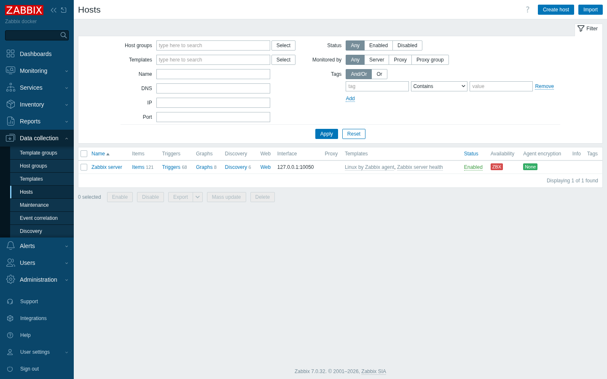
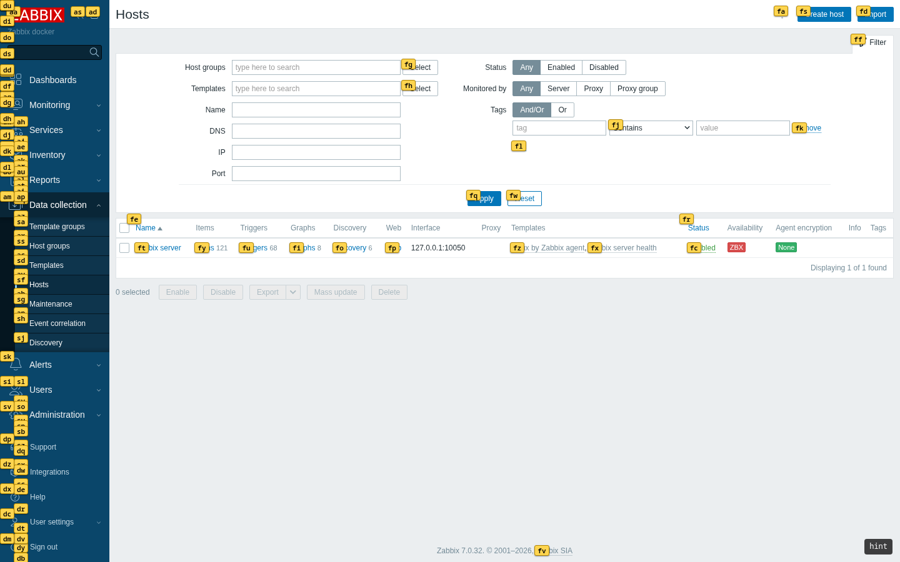
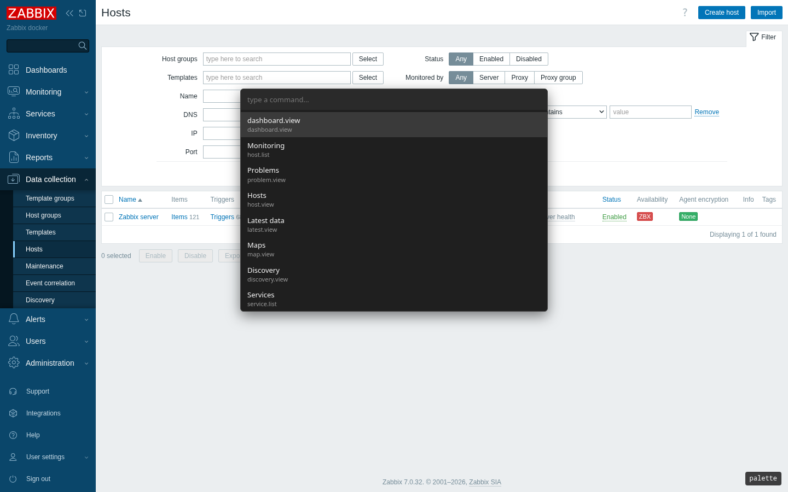
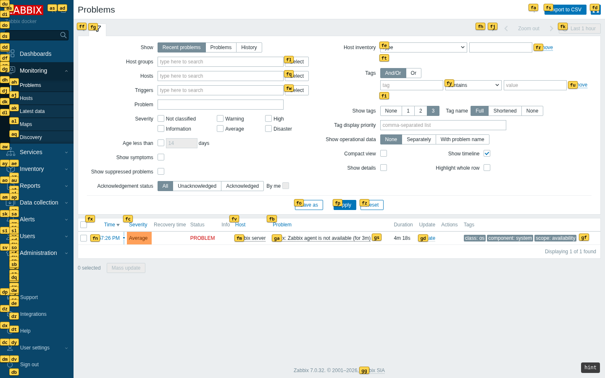
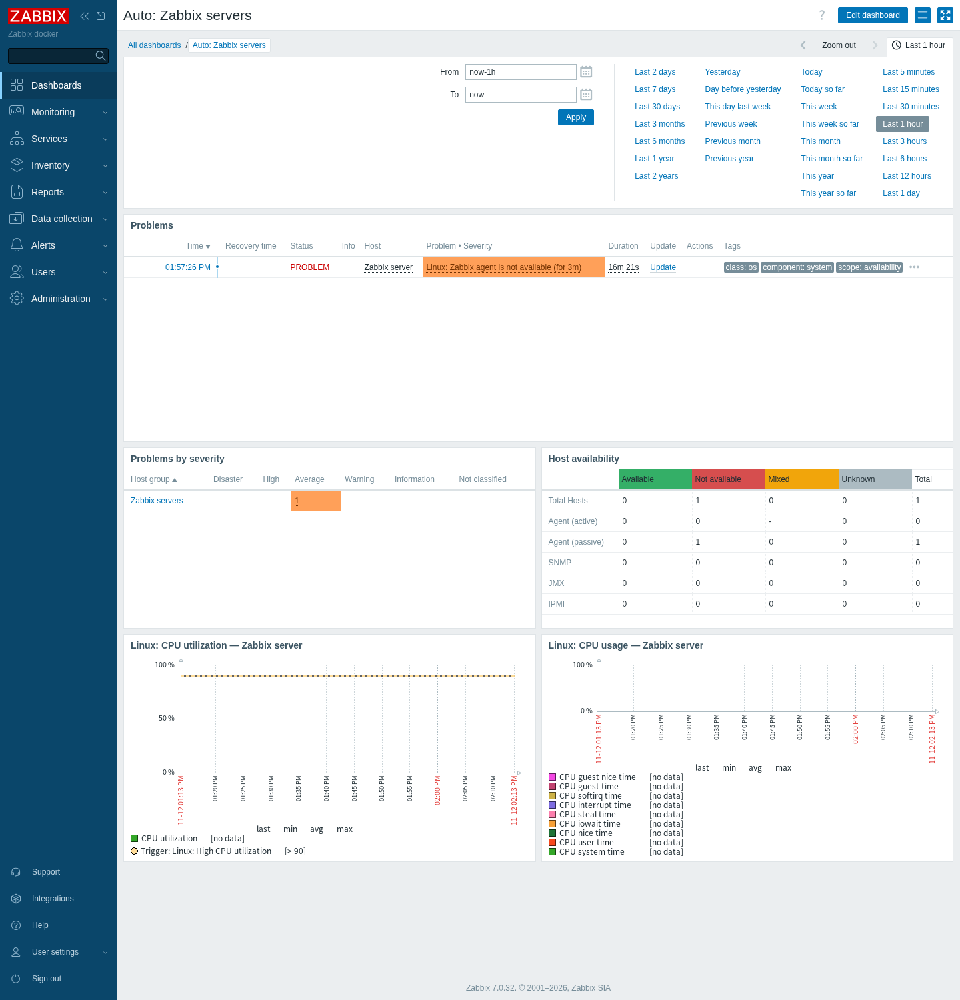
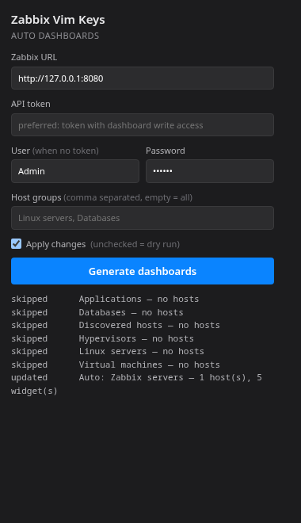

# Zabbix Vim Keys

Vim-style keyboard navigation and hint mode for the Zabbix web frontend. Manifest V3, works in Firefox and Chromium, no build dependencies beyond Node.js.

The extension is a content script only: it injects a keyboard layer on top of the page, renders its UI in a shadow root, and never talks to the network or stores credentials.

## Screenshots

Real Zabbix 7.0.32 instance, extension loaded unpacked:

| Normal | Hint mode (`f`) |
| --- | --- |
|  |  |

| Command palette (`:`) | Hint mode on the problem list |
| --- | --- |
|  |  |

An automatically provisioned dashboard (problems, severity, host availability, CPU graphs), and the popup that generates it:





## Quick start (no build)

Prebuilt bundles are committed under `dist/`, so you can load the extension straight from a download.

1. Download the repository as a ZIP (`Code` → `Download ZIP`) and extract it.
2. Load the extension:
   - **Chromium** (Chrome, Edge, Brave): open `chrome://extensions`, enable **Developer mode**, click **Load unpacked**, select `dist/chromium`.
   - **Firefox**: open `about:debugging#/runtime/this-firefox`, click **Load Temporary Add-on…**, select `dist/firefox/manifest.json`.
3. Open your Zabbix frontend and press `f`.

That is the whole setup. The content script activates only on pages that look like a Zabbix frontend, so it stays inert on every other tab.

The Firefox route above is temporary and lasts until the browser restarts. A permanent install requires signing through AMO, or Firefox Developer Edition with `xpinstall.signatures.required` set to `false`.

## Verify it works

Open any Zabbix page (host list or problem list works best) and check:

- `f` shows yellow hint labels over links and buttons,
- `:` opens the command palette listing your navigation entries,
- the bottom-right corner shows the current mode (`normal`, `insert`, `hint`, `palette`).

If nothing happens, see [Troubleshooting](#troubleshooting).

## Troubleshooting

- **No HUD and no shortcuts** — the page was not recognised as Zabbix. Detection requires at least two Zabbix-style links (`zabbix.php?action=…` or legacy `*.php` pages); try the host or problem list instead of the login screen.
- **Shortcuts are ignored** — focus is inside a text field. Press `Esc`, then try again.
- **Extension fails to load** — make sure you selected the directory that directly contains `manifest.json` (`dist/chromium`, not `dist` or the repository root).
- **Errors** — open DevTools on the Zabbix tab and check the console after switching the execution context to the extension.

## Features

- **Normal/insert/hint/palette modes** — keys pass through untouched while typing in inputs, textareas, selects, and contenteditable elements.
- **Hint mode** — labels every visible link, button, and clickable element; typing filters candidates; `F` opens the target in a new tab.
- **Command palette** — commands are discovered from the page's own navigation (`zabbix.php?action=…` and legacy `*.php` links), deduplicated by action, so no URLs are hardcoded.
- **Multi-key bindings** — `gg`, `gh`, `gp`, … resolve through a small sequence matcher.
- **HUD** — current mode and pending key prefix, bottom right.
- **Page detection** — a page is treated as Zabbix when it contains at least two Zabbix-style navigation links, so the content script stays inert everywhere else.

## Key bindings

| Key | Action |
| --- | --- |
| `j` / `k` | scroll down / up |
| `d` / `u` | half page down / up |
| `h` / `l` | scroll left / right |
| `gg` / `G` | scroll to top / bottom |
| `f` / `F` | hint mode (same tab / new tab) |
| `:` | command palette |
| `/` | focus the Zabbix search field |
| `gh` `gp` `gl` `gd` `gm` | hosts, problems, latest data, dashboards, maps |
| `i` | insert mode (let the page handle keys) |
| `Esc` | leave hint/palette/insert mode, clear pending keys |

Inside hint mode: type the label to follow it, `Backspace` removes the last character, `Esc` cancels.

## Build from source

```bash
npm run build   # writes dist/chromium and dist/firefox
npm test        # node:test unit tests
npm run check   # syntax-check the built bundles
```

No build dependencies: `scripts/build.mjs` inlines the ESM module graph into a single IIFE, because content scripts cannot be ES modules. The script also rejects duplicate top-level declarations, which would otherwise collide silently in the shared scope. After rebuilding, click the reload icon on the extension card and refresh the Zabbix tab.

### Layout

```
src/
  content/main.js     wiring: modes, key bindings, commands
  popup/              toolbar popup: dashboard generator UI
  api/                Zabbix JSON-RPC client (token or session)
  core/               pure logic (keymap, labels, modes, page parsing, dashboard builder, provisioner)
  zabbix/             Zabbix-specific detection and DOM selectors
  ui/                 hint overlay, palette, HUD, shadow root
  manifest.*.json     per-browser manifests
dist/                 committed builds loaded as unpacked extensions
docs/screenshots/     screenshots captured against a real instance
scripts/              build and screenshot helpers
tests/                unit tests (node:test)
tests/e2e/            end-to-end tests against a live Zabbix
scripts/provision-dashboards.mjs   dashboard provisioner (CLI)
```

Zabbix-specific code lives only in `src/zabbix/` and in the command definitions in `src/content/main.js`; everything else is generic.

## Testing

Unit tests cover the pure logic and need nothing but Node.js:

```bash
npm test
```

The end-to-end suite loads `dist/chromium` into Chromium through Playwright and drives a live Zabbix instance. Install the browser once and point the suite at your frontend:

```bash
npx playwright install chromium
ZBX_URL=http://127.0.0.1:8080 npm run test:e2e
```

`ZBX_USER` and `ZBX_PASSWORD` default to `Admin` / `zabbix`. The suite skips itself when `ZBX_URL` is unset, so `npm test` stays hermetic. It covers: content-script injection, staying inert on non-Zabbix pages, hint mode, hint activation, palette open/filter/close, the insert-mode switch on form focus, and the popup's dry-run dashboard generation. The popup test never writes to the Zabbix configuration.

Regenerate the README screenshots from a running instance with:

```bash
ZBX_URL=http://127.0.0.1:8080 npm run screenshots
```

## Automatic dashboards

`scripts/provision-dashboards.mjs` creates one real Zabbix dashboard per host group, so it shows up in the frontend for every user and in kiosk mode. Each dashboard gets a full-width Problems widget, Problems by severity, Host availability, and up to two graphs per host (CPU and memory graphs are preferred, taken round-robin so one noisy host cannot fill the page).

It is idempotent: a dashboard is matched by name and updated in place, so you can re-run it on a schedule. Groups without hosts are skipped; pass `--include-empty` if you want an empty dashboard for them.

There are two ways to run it: from the extension popup (toolbar icon → *Generate dashboards*) or from the command line. The popup stores the URL, token, user and group filter locally, and has an *Apply changes* checkbox; unchecked means dry run. Only the URL, token, user name and group filter are stored — never the password.

```bash
# preview what would be created for one group
ZBX_URL=http://127.0.0.1:8080 ZBX_PASSWORD=zabbix \
  npm run dashboards -- --group "Linux servers"

# write changes for every group
ZBX_URL=http://127.0.0.1:8080 ZBX_TOKEN=<api-token> \
  npm run dashboards -- --apply

# custom layout limits and name
ZBX_URL=http://127.0.0.1:8080 ZBX_TOKEN=<api-token> \
  npm run dashboards -- --apply --graphs-per-host 3 --max-graphs 12 --name "Ops: {group}"
```

Options: `--url`, `--token`, `--user` / `--password` (session login fallback), `--group` (repeatable, accepts name or id), `--name`, `--graphs-per-host`, `--max-graphs`, `--apply`.

The token needs permission to create and update dashboards. Cron example:

```cron
*/30 * * * * cd /path/to/zabbix-vim && ZBX_URL=https://zabbix.example ZBX_TOKEN=... node scripts/provision-dashboards.mjs --apply >/dev/null 2>&1
```

## Status

Validated end-to-end against **Zabbix 7.0.32** (frontend in Podman, Chromium 141, Playwright). Unit tests cover the pure logic and the dashboard payload builder; the end-to-end suite exercises the real DOM, and the provisioner was run against the live instance.

Scope is deliberately read-only: navigation, scrolling, hints, and a command palette. No API calls, no mutations (acknowledge, maintenance, disable).

## Known limitations

- Host detection is heuristic and the `matches` pattern is broad (`http://*/*`, `https://*/*`); there is no per-instance allowlist yet.
- Hints are collected when hint mode starts; live re-scanning while the DOM changes (dashboards, AJAX filters) is not implemented.
- Graphs and SVG dashboard widgets are not keyboard-navigable.
- The palette lists navigation targets, not arbitrary Zabbix actions.
- Only Zabbix 7.0 has been tested; older frontends use different DOM and may need selector tweaks.
